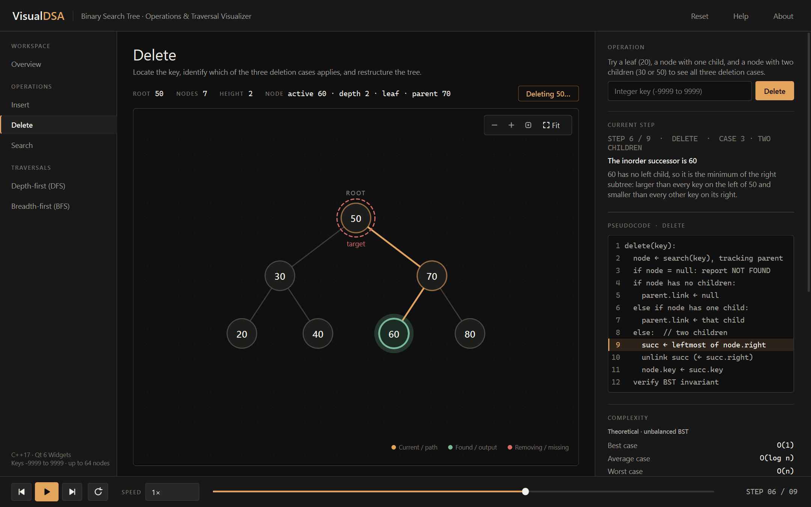

# VisualDSA

**Interactive Binary Search Tree Operations and Traversal Visualizer**: a Data Structures and Algorithms mini project in C++17 with Qt 6 Widgets, with a matching **web version** that runs in any modern browser.

VisualDSA runs real BST algorithms on a real C++ tree and replays every step they took: comparisons, the path from the root, deletion cases, the inorder successor, transactional updates and traversal order. Every animation is a replay of events recorded while the algorithm ran. Nothing is drawn that the algorithm did not do.



## Features

| Operation | What you see |
|---|---|
| **Insert** | Each comparison, the branch taken, the empty slot where the key lands, then the new node growing in. Duplicates are rejected. |
| **Delete** | Search, identification of case 1 (leaf), case 2 (one child) or case 3 (two children), the walk to the inorder successor, unlinking and key replacement. |
| **Search** | Root-to-node path, a live `45 > 30` comparison badge, found (green) or the null pointer where the search ended (red). |
| **Update** | Old key located, new key checked for conflicts, then delete + insert on a **working copy** that is committed only after the invariant check passes. |
| **Traversals** | Inorder, preorder and postorder with recursion entry and output steps, order badges on nodes and a progressive output strip. |

Also included:

- A pseudocode panel synchronized by stable line IDs.
- Step-by-step explanations generated from event data.
- Theoretical complexity shown separately from counters measured during the run.
- Playback controls: previous, play/pause, next, restart, 0.5×–4× speed, and a draggable timeline.
- Zoom, pan and fit-to-view on the canvas, plus click-to-inspect for nodes.
- An operation history that can be replayed.
- An Algorithm Reference page.

## Requirements

| Tool | Version | Notes |
|---|---|---|
| C++ compiler | C++17 | Tested with **MSVC 19.44 (Visual Studio 2022 Build Tools)**. GCC 9+ and Clang 10+ should also work. |
| Qt | **6.2 or newer** (Widgets, Test) | Tested with **Qt 6.8.3, msvc2022_64**. |
| CMake | **3.22 or newer** | |
| Generator | Ninja or Visual Studio 17 2022 | Ninja ships with Visual Studio. |

## Build and run on Windows

Open the **x64 Native Tools Command Prompt for VS 2022**. This puts `cl`, `cmake` and `ninja` on PATH. Then run:

```bat
cd VisualDSA
cmake -S . -B build -G Ninja -DCMAKE_BUILD_TYPE=Release -DCMAKE_PREFIX_PATH=C:\Qt\6.8.3\msvc2022_64
cmake --build build
ctest --test-dir build --output-on-failure
build\bin\VisualDSA.exe
```

Replace `C:\Qt\6.8.3\msvc2022_64` with your own Qt installation folder: the one that contains `bin\qmake.exe`.

You can use the Visual Studio generator instead of Ninja:

```bat
cmake -S . -B build -G "Visual Studio 17 2022" -A x64 -DCMAKE_PREFIX_PATH=C:\Qt\6.8.3\msvc2022_64
cmake --build build --config Release
ctest --test-dir build -C Release --output-on-failure
build\bin\Release\VisualDSA.exe
```

On Windows, a post-build step runs `windeployqt`, which copies the Qt DLLs next to `VisualDSA.exe` so it can be double-clicked. Turn this off with `-DVISUALDSA_DEPLOY_QT=OFF`.

### Getting Qt 6 without the online installer

If you do not have Qt yet, the open-source `aqtinstall` tool can download the official binaries:

```bat
python -m pip install aqtinstall
python -m aqt install-qt windows desktop 6.8.3 win64_msvc2022_64 -O C:\Qt
```

## Build and run on Linux

```bash
sudo apt install build-essential cmake ninja-build qt6-base-dev   # Ubuntu 22.04+
cmake -S . -B build -G Ninja -DCMAKE_BUILD_TYPE=Release
cmake --build build
ctest --test-dir build --output-on-failure
./build/bin/VisualDSA
```

## Web version

The [`web/`](web/) folder holds the same visualizer as a static website. It needs no build step and has no dependencies: plain HTML, CSS and JavaScript, drawn on an HTML canvas.

- **Open it directly:** double-click `web/index.html`.
- **Or serve it locally:** `python -m http.server 8000 --directory web`, then open <http://localhost:8000>.
- **Host it:** upload the contents of `web/` to any static host (GitHub Pages, Netlify and so on).

The web version is a direct port of the C++ layers. It uses the same algorithms, the same recorded events and explanation text, the same pseudocode and complexity tables, and the same canvas layout and colours. It includes every desktop feature: all five operations, playback with speed and timeline, zoom/pan/fit, click-to-inspect, replayable history, the Algorithm Reference page and the keyboard shortcuts. The layout adapts down to phone width.

| Web file | Ported from |
|---|---|
| `web/js/core.js` | `src/core/` (BinarySearchTree, Recorder, TreeSnapshot, TreeValidator) |
| `web/js/pseudocode.js` | `src/core/Pseudocode.cpp` |
| `web/js/validation.js` | `src/utils/Validation.cpp` |
| `web/js/canvas.js` | `src/visualization/TreeLayout.cpp`, `TreeCanvas.cpp` |
| `web/js/animation.js` | `src/visualization/AnimationController.cpp` |
| `web/js/app.js`, `web/index.html`, `web/css/style.css` | `src/ui/` and `resources/styles/theme.qss` |

The web core has its own test suite, ported from the Qt Test cases (Node.js 18 or newer):

```bash
node --test web/tests/core.test.js
```

## CMake options

| Option | Default | Meaning |
|---|---|---|
| `VISUALDSA_BUILD_APP` | ON | Build the GUI. Set it to OFF to build only the Qt-free core plus the core tests. |
| `VISUALDSA_BUILD_TESTS` | ON | Build the Qt Test suites and register them with CTest. |
| `VISUALDSA_DEPLOY_QT` | ON | Windows only: run `windeployqt` after building the app. |
| `VISUALDSA_BUILD_TOOLS` | OFF | Build `capture_screenshots`, which regenerates `screenshots/` by driving the real window. |

## Project structure

```
VisualDSA/
├── CMakeLists.txt            top-level build (core, visualization, ui, app, tools)
├── src/
│   ├── core/                 Layer A: pure C++17 BST engine, no Qt
│   │   ├── BSTNode.h             node with unique_ptr children + stable id
│   │   ├── BinarySearchTree.*    insert / remove / search / update / traverse / rebuild
│   │   ├── AlgorithmEvent.h      typed event model (EventType, PseudoLine, metrics …)
│   │   ├── TreeSnapshot.h        pointer-free snapshot of the tree
│   │   ├── OperationResult.h     result + OperationRecord (events + snapshots)
│   │   ├── TreeValidator.h       BST invariant checks for trees and snapshots
│   │   └── Pseudocode.*          pseudocode listings and complexity table
│   ├── utils/Validation.*    input parsing (keys, key lists, overflow, duplicates)
│   ├── visualization/        Layer B: TreeLayout, TreeCanvas (QPainter),
│   │                         AnimationController (QTimer), Palette (design tokens)
│   ├── ui/                   Layer C: MainWindow and panels, Theme, Icons
│   └── main.cpp
├── resources/                theme.qss (token-based stylesheet), resources.qrc
├── tests/                    Layer D: four Qt Test suites run by CTest
├── web/                      browser version: index.html, css/, js/ (port of the
│                             layers above), tests/ (Node test suite)
├── tools/                    screenshot generator
├── screenshots/              generated PNGs of every operation
└── docs/                     report, algorithms, complexity, tests, user guide, viva
```

The core library has **no Qt dependency**. The GUI never mutates the tree directly. It calls one of the tree's public operations, receives an `OperationRecord`, and hands that record to the `AnimationController` for playback.

## Documentation

- [Project report](docs/PROJECT_REPORT.md)
- [Algorithm documentation](docs/ALGORITHM_DOCUMENTATION.md)
- [Complexity analysis](docs/COMPLEXITY_ANALYSIS.md)
- [Test cases and results](docs/TEST_CASES.md)
- [User guide](docs/USER_GUIDE.md)
- [Viva questions](docs/VIVA_QUESTIONS.md)

## Troubleshooting

| Problem | Fix |
|---|---|
| `Could not find a package configuration file provided by "Qt6"` | Pass `-DCMAKE_PREFIX_PATH=<Qt folder>`, for example `C:\Qt\6.8.3\msvc2022_64`. |
| `No CMAKE_CXX_COMPILER could be found` | Build from the *x64 Native Tools Command Prompt*, or install the "Desktop development with C++" workload. |
| Qt kit and compiler mismatch, with link errors such as `LNK2019` on Qt symbols | Use the MSVC Qt build (`msvc2022_64`) with MSVC, or the MinGW Qt build with MinGW. Do not mix them. |
| `VisualDSA.exe` says `Qt6Core.dll` was not found | Keep `VISUALDSA_DEPLOY_QT=ON`, or add `<Qt folder>\bin` to PATH. |
| `This application failed to start because no Qt platform plugin could be initialized` | Run the copy in `build\bin` (where `windeployqt` placed `platforms\qwindows.dll`), or set `QT_PLUGIN_PATH=<Qt folder>\plugins`. |
| Stale build after changing the Qt version | Delete the `build` folder and configure again. |

## License

MIT. See [LICENSE](LICENSE).
