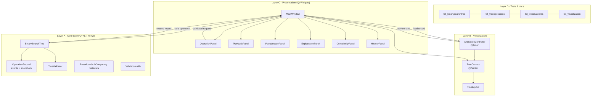
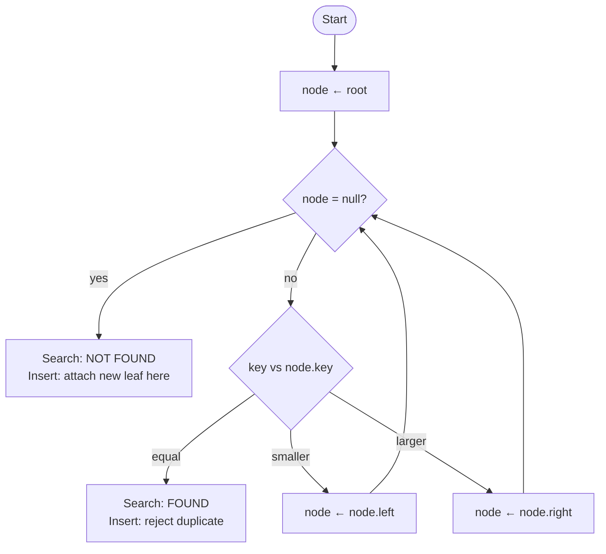
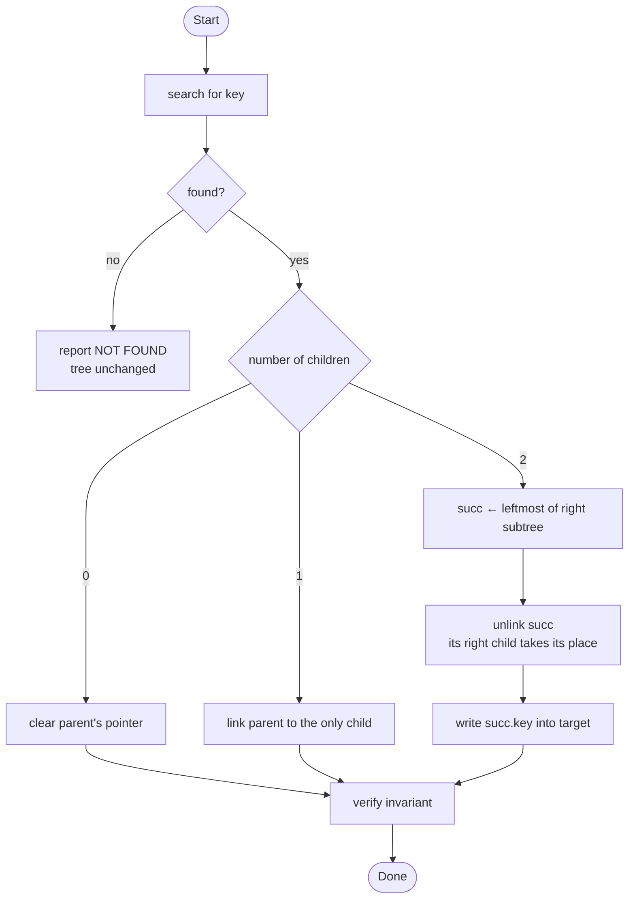
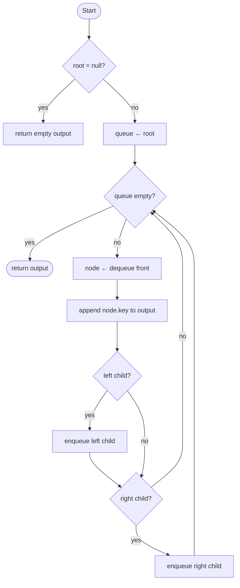

# VisualDSA: Interactive Binary Search Tree Operations and Traversal Visualizer

## 1. Title Page

| | |
|---|---|
| **Project title** | VisualDSA: Interactive Binary Search Tree Operations and Traversal Visualizer |
| **Course** | Data Structures and Algorithms: Mini Project |
| **Submitted by** | `[STUDENT NAME 1]` (`[REGISTRATION NO. 1]`)<br>`[STUDENT NAME 2]` (`[REGISTRATION NO. 2]`)<br>`[STUDENT NAME 3]` (`[REGISTRATION NO. 3]`) |
| **Department** | `[DEPARTMENT NAME]` |
| **Institution** | `[INSTITUTION NAME]` |
| **Guide / Faculty** | `[GUIDE NAME, DESIGNATION]` |
| **Academic year** | `[20XX–20XX]` |
| **Date of submission** | `[DATE]` |

> Replace every bracketed placeholder before submission. Do not add approval statements or signatures that have not actually been given.

---

## 2. Abstract

Binary Search Trees (BSTs) are central to the study of data structures, yet students often find their behaviour hard to follow from static diagrams. This is especially true of the deletion of a node with two children and the different visiting orders of tree traversals.

This project presents VisualDSA, a native desktop application written in C++17 with the Qt 6 Widgets framework. It demonstrates the fundamental BST operations: insertion, deletion and searching, together with the depth-first traversals (inorder, preorder and postorder) and the breadth-first, level-order traversal (BFS). A matching web version, ported from the same C++ design, runs in any modern browser.

Each operation is executed by a genuine C++ BST implementation built on `std::unique_ptr` ownership. While running, the algorithm records a typed event stream and pointer-free snapshots of the tree. The graphical interface replays this recording step by step and synchronizes four views:

- an animated tree canvas,
- the matching pseudocode line,
- a generated explanation of the step, and
- complexity information that separates theoretical bounds from measured counters.

The breadth-first traversal shows its first-in, first-out queue at every step, so students can see why the tree is visited level by level. Correctness is checked by an invariant validator after every structural change and by four automated test suites, which include randomized differential testing against `std::set`. All suites pass.

---

## 3. Introduction

A Binary Search Tree stores keys so that an in-order walk yields them in sorted order, and so that search, insertion and deletion take time proportional to the tree's height. Textbooks describe these operations with static figures, but the important ideas are dynamic:

- which subtree is discarded at each comparison,
- why a new key must become a leaf at one specific position,
- how the inorder successor preserves ordering after a deletion, and
- how the three depth-first traversals differ only in *when* a node is output, and
- how a queue turns the same tree into a level-by-level (breadth-first) visit.

VisualDSA makes these ideas visible. Its guiding principle is that **every animation corresponds to a real algorithmic step**: the GUI cannot show anything that the C++ algorithm did not actually do.

---

## 4. Problem Statement

The goal was to design and implement, in C++, an interactive application that:

1. Implements a correct BST supporting insertion, deletion (all three cases), searching, the three depth-first traversals and the breadth-first (level-order) traversal.
2. Visually explains each operation step by step, with synchronized pseudocode and plain-language explanations.
3. Preserves the BST invariant and data integrity under all inputs, including invalid, duplicate and missing keys.
4. Reports accurate time and space complexity and keeps measured counters distinct from theoretical bounds.
5. Is suitable for a live classroom demonstration.

---

## 5. Objectives

- Implement a BST with safe, RAII-based memory management and a strict no-duplicates policy.
- Record every algorithm step as structured data (events and snapshots) that is independent of live pointers.
- Build a polished Qt Widgets interface with:
  - a custom QPainter canvas,
  - synchronized pseudocode,
  - explanations,
  - complexity information, and
  - deterministic playback (play, pause, step, restart, speed, timeline).
- Visualize breadth-first traversal together with the queue that drives it.
- Validate the BST invariant after every successful structural mutation.
- Provide automated tests for both the algorithms and the visualization logic.
- Document the algorithms, their complexity, the test results and the user guide.

---

## 6. Existing System and Its Limitations

| Existing approach | Limitation |
|---|---|
| Textbook diagrams and lecture slides | Static. Intermediate states, such as the successor walk, must be imagined. |
| Hand-tracing on paper | Slow and error-prone for larger trees; gives no feedback on mistakes. |
| Console programs that print traversal results | Show only final outputs, not how they were produced. |
| Generic online animation tools | Often not tied to inspectable source code. Behaviour (e.g. duplicate handling, successor vs. predecessor) may differ from the course's algorithm. Typically web-based rather than a C/C++/Java implementation. |

---

## 7. Proposed System

VisualDSA is a C++ desktop application in which:

- The **real algorithm runs first** on the live tree and returns an `OperationRecord`. This contains the result, every step as an `AlgorithmEvent`, and every distinct tree state as a `TreeSnapshot`.
- The **GUI replays the record**: canvas highlights, comparison badges, ghost slots for empty positions, synchronized pseudocode, explanations and counters.
- Users can pause, step backwards and forwards, change the speed, scrub the timeline, and replay any recent operation from the history.
- Invalid input is rejected with specific messages before the tree is touched.

**Advantages:**

- Correctness is tied directly to the source code.
- Visual steps are generated from data and are never hand-scripted.
- The tree can be inspected at every intermediate state.

---

## 8. Software and Hardware Requirements

### Software

| Component | Requirement | Used during development |
|---|---|---|
| Operating system | Windows 10/11 (primary) or Linux | Windows 11 |
| Compiler | C++17 (MSVC 2019+, GCC 9+, Clang 10+) | MSVC 19.44 (VS 2022 Build Tools) |
| Framework | Qt 6.2+ (Core, Gui, Widgets, Test) | Qt 6.8.3 msvc2022_64 |
| Build system | CMake 3.22+ with Ninja or Visual Studio | CMake (bundled with VS 2022), Ninja |

### Hardware (minimum, indicative)

- x86-64 processor
- 4 GB RAM
- Display of at least 1280×800 (the application's minimum window size is 1120×720)
- About 300 MB of disk space for Qt runtime libraries and build output

---

## 9. Technology Stack

| Technology | Purpose |
|---|---|
| C++17 | Algorithm engine, ownership via `std::unique_ptr`, `std::optional`, structured bindings |
| Qt 6 Widgets | Main window, panels, input controls |
| QPainter | Custom drawing of nodes, edges, badges and overlays |
| QVariantAnimation | Eased transitions of node positions between snapshots |
| QTimer | Single, controllable playback clock |
| Qt signals/slots | Decoupled communication between panels, controller and window |
| Qt Style Sheets | Dark editorial theme built from shared design tokens |
| Qt Test + CTest | Automated unit and GUI tests |
| CMake | Cross-platform build configuration |

---

## 10. System Architecture



**Data flow for one operation:**

1. The user enters a key and `OperationPanel` validates it.
2. `MainWindow` calls `tree_.insert(key)` (or another operation).
3. The algorithm mutates the live tree and returns an `OperationRecord`.
4. The record is added to the history and loaded into `AnimationController`.
5. On each step change, `MainWindow` updates the canvas, pseudocode line, explanation, counters and status from the same `AlgorithmEvent`.

The core library has no dependency on Qt, so it is tested in isolation. The UI never mutates the tree except through the tree's public operations.

---

## 11. Data Structure Design

```cpp
struct BSTNode {
    int key;
    NodeId id;                       // stable, never reused
    std::unique_ptr<BSTNode> left, right;
};

class BinarySearchTree {
    std::unique_ptr<BSTNode> root_;
    std::size_t size_;
    NodeId nextId_;
    std::size_t capacity_;
};
```

Supporting types:

- **`TreeSnapshot`**: a vector of `{id, key, parent, left, right, depth}` records with no pointers.
- **`AlgorithmEvent`**: holds the event type, operation, pseudocode line id, snapshot index, primary node and emphasis, compared key, direction, secondary node and its role, any empty slot, deletion case, active path, traversal output so far, the BFS queue, cumulative metrics, and the action/reason text.
- **`OperationRecord`**: the result plus its events and snapshots.

**Design decisions:**

- **Single ownership.** `unique_ptr` makes the tree's ownership structure explicit and leak-free.
- **Stable ids.** Nodes are animated by identity and snapshots stay valid after deletions.
- **Owning-link pointers** (`unique_ptr<BSTNode>*`). Deleting the root is identical to deleting any other node.
- **Strongly typed enums** (`EventType`, `PseudoLine`, `Emphasis`, `ResultStatus`, ...). Behaviour never depends on matching strings.

---

## 12. Binary Search Tree Properties

1. For each node, every key in its left subtree is smaller and every key in its right subtree is larger.
2. Keys are unique (the project's policy).
3. An inorder traversal yields the keys in ascending order.
4. Search, insertion and deletion take O(h) time, where h is the height.
   - For a balanced shape, h ≈ log₂ n.
   - For a skewed tree (e.g. sorted insertions), h = n − 1.
5. A plain BST does not rebalance itself. O(log n) is the average case, not a guarantee.

The validator enforces property 1 over whole subtrees by passing open intervals down the tree. It also detects duplicate keys, duplicate ids and nodes reachable twice.

---

## 13. Insertion Algorithm

```
insert(key):
  node ← root;  parent ← null
  while node ≠ null:
    compare key with node.key
    if key = node.key: reject duplicate
    if key < node.key: go left
    else: go right
  attach Node(key) under parent
  verify invariant; return success
```

The key follows its own search path, and the first empty pointer on that path is the unique valid position, so the new node is always a leaf.

**Visualization:** each comparison is shown with a `45 > 30` badge, the path is shown in amber, and the destination appears as a dashed `+45` slot under its future parent. The node then grows into place.

**Example** (sample tree, insert 45): compare with 50 (go left), 30 (go right) and 40 (go right). The right child of 40 is empty, so 45 is attached there.

---

## 14. Deletion Algorithm and Its Three Cases

```
delete(key):
  node ← search(key), tracking parent
  if node = null: report NOT FOUND
  if node has no children:            parent.link ← null
  else if node has one child:         parent.link ← that child
  else:  // two children
    succ ← leftmost of node.right
    unlink succ (← succ.right)
    node.key ← succ.key
  verify BST invariant
```

| Case | Example on the sample tree | Result |
|---|---|---|
| Leaf | delete 20 | 30's left pointer becomes null |
| One child | delete 20, then 30 | 40 replaces 30 |
| Two children | delete 50 | successor 60 is unlinked; the root key becomes 60 |

**Why the successor is correct:** it is larger than every key in the left subtree and smaller than every other key in the right subtree.

**Implementation detail:** the successor is unlinked *before* its key is copied. This produces the same final tree as the textbook order, but no intermediate state ever contains a duplicate key, so every displayed step is a valid BST.

---

## 15. Searching Algorithm

```
search(key):
  node ← root
  while node ≠ null:
    compare key with node.key
    if key = node.key: return FOUND
    if key < node.key: node ← node.left
    else: node ← node.right
  return NOT FOUND
```

The search is iterative and uses O(1) extra space. On success, the node turns green. On failure, the null pointer where the search ended is drawn in red, showing why the key cannot exist anywhere else.

---

## 16. Inorder Traversal

```
inorder(node):
  if node = null: return
  inorder(node.left)
  output.append(node.key)
  inorder(node.right)
```

For the sample tree, the output is 20, 30, 40, 50, 60, 70, 80. For any BST, this order is sorted.

---

## 17. Preorder Traversal

```
preorder(node):
  if node = null: return
  output.append(node.key)
  preorder(node.left)
  preorder(node.right)
```

For the sample tree, the output is 50, 30, 20, 40, 70, 60, 80. Re-inserting keys in this order rebuilds the same tree.

---

## 18. Postorder Traversal

```
postorder(node):
  if node = null: return
  postorder(node.left)
  postorder(node.right)
  output.append(node.key)
```

For the sample tree, the output is 20, 40, 30, 60, 80, 70, 50. This is the order used to free a tree bottom-up.

The visualizer records both *entering* a node and *outputting* it. All three traversals enter nodes in the same sequence, but the moment of output differs, and this difference is exactly what the animation highlights. Output nodes turn green with a small badge showing their output position, and an output strip grows at the bottom of the canvas.

---

## 19. Breadth-first (Level-order) Traversal

```
levelorder(root):
  if root = null: return [ ]
  queue ← [root];  output ← [ ]
  while queue is not empty:
    node ← queue.dequeue()
    output.append(node.key)
    if node.left: enqueue(node.left)
    if node.right: enqueue(node.right)
  return output
```

For the sample tree, the output is 50, 30, 70, 20, 40, 60, 80: level by level, [50] [30, 70] [20, 40, 60, 80].

Breadth-first search replaces the recursion stack with a first-in, first-out queue. A node's children join the back of the queue when it is dequeued, so every node at depth *d* leaves the queue before any node at depth *d* + 1. The visualizer records each dequeue, output and enqueue, and every step carries the queue contents. Waiting nodes get a dashed amber ring. A QUEUE strip above the output strip and the right panel list them from front to back, and the explanation marks the moment each new level starts.

BFS takes Θ(n) time, like the depth-first orders, but its extra space is the queue, O(w) for the widest level w. That is up to about n/2 for a full tree, but only 1 for a skewed tree, the reverse of the depth-first stack.

---

## 20. Flowcharts

### Search and insertion



### Deletion



### Breadth-first traversal



---

## 21. Time and Space Complexity Analysis

n = number of nodes; h = height in edges.

| Operation | Best | Average | Worst | Auxiliary space |
|---|---|---|---|---|
| Search | O(1) | O(log n) | O(n) | O(1), iterative |
| Insertion | O(1) | O(log n) | O(n) | O(1), iterative |
| Deletion | O(1) | O(log n) | O(n) | O(1), iterative |
| Inorder / Preorder / Postorder (DFS) | O(n) | O(n) | O(n) | O(h) stack + O(n) output |
| Level order (BFS) | O(n) | O(n) | O(n) | O(w) queue + O(n) output, w = widest level |

All path-based operations cost O(h). Since this tree does not rebalance, h can reach n − 1, so O(log n) is only the average case.

The application shows these bounds next to counters measured during the run: nodes visited, key comparisons, traversal outputs and structural changes. Animation speed never affects the measured counters.

The full derivation is in [`COMPLEXITY_ANALYSIS.md`](COMPLEXITY_ANALYSIS.md).

---

## 22. User Interface Description

The interface uses a dark editorial design:

| Token | Colour |
|---|---|
| Background | `#101010` |
| Surfaces | `#181818` to `#272727` |
| Primary text | `#F2F0EB` |
| Accent (amber) | `#E5A45C` |
| Success (green) | `#78B99A` |
| Error (red) | `#D96C69` |

Green and red are used only for meaningful states. Colours are defined once as tokens and shared by the QPainter canvas and the Qt style sheet.

| Region | Contents |
|---|---|
| Top bar | VisualDSA wordmark, subtitle, Reset, Help, About |
| Sidebar | Workspace: Overview · Operations: Insert, Delete, Search · Traversals: Depth-first (DFS), Breadth-first (BFS) |
| Workspace | Module title and description; root, node count, height and selected-node information; status badge; the tree canvas with zoom, fit and actual-size controls |
| Right panel | Operation inputs, current-step explanation, synchronized pseudocode, complexity (theoretical vs. measured), operation history |
| Playback bar | Previous, play/pause, next, restart, speed (0.5×–4×), timeline, step counter |

Screenshots of every operation are in [`screenshots/`](../screenshots). Usage instructions are in [`USER_GUIDE.md`](USER_GUIDE.md).

---

## 23. Testing Methodology

- **Unit testing (Qt Test).** The core engine is tested without any GUI: each operation, each edge case and the event stream itself.
- **Invariant testing.** The validator is tested against deliberately invalid trees. The live tree is validated after every operation in the randomized test.
- **Differential testing.** 3000 seeded random operations (insert, delete, search) are compared against `std::set` as a reference model.
- **Stress testing.** A 20,000-node skewed tree is built, cleared and destroyed to confirm that deallocation does not overflow the stack.
- **GUI testing.** The `offscreen` Qt platform is used to test:
  - layout overlap,
  - canvas node and edge counts and highlights,
  - click selection,
  - playback boundaries, pause/resume, end state and cancellation, and
  - step-by-step synchronization between events, pseudocode, explanation, canvas and counters, on the real `MainWindow`.
- **Manual visual inspection.** Screenshots of the real window were taken at each demonstration step and inspected.
- **Build hygiene.** The code compiles at MSVC `/W4 /permissive-` with no warnings.

---

## 24. Test Cases and Results

Tests were executed on 2026-10-26 (Windows 11, MSVC 19.44, Qt 6.8.3) with `ctest --test-dir build --output-on-failure`.

| Suite | Coverage | QtTest results | Status |
|---|---|---|---|
| `tst_binarysearchtree` | insertion, search, DFS and BFS traversals (including queue order), pseudocode mapping, input parsing | 42 | Passed |
| `tst_treeoperations` | all deletion cases, snapshots, metrics, tree management | 20 | Passed |
| `tst_treeinvariants` | validator, snapshots, clone, deep tree, randomized vs. `std::set` | 14 | Passed |
| `tst_visualization` | layout, canvas, controller, main-window integration (including BFS) | 23 | Passed |
| **Total** | | **99** | **100% passed** |

Representative cases:

| Case | Input | Expected | Result |
|---|---|---|---|
| Duplicate insertion | insert 40 into the sample tree | rejected; tree unchanged | Pass |
| Delete leaf | delete 20 | preorder 50, 30, 40, 70, 60, 80 | Pass |
| Delete two children | delete 30 | successor 40; preorder 50, 40, 20, 70, 60, 80 | Pass |
| Delete missing | delete 65 | not found; tree unchanged | Pass |
| Depth-first traversals | sample tree | inorder, preorder and postorder as in sections 16–18 | Pass |
| Breadth-first traversal | sample tree | 50, 30, 70, 20, 40, 60, 80; queue is first-in, first-out; at most 4 nodes waiting | Pass |
| Invalid input | `abc`, `4.5`, `99999999999`, `10, 20, 10` | specific error message; tree unchanged | Pass |

The complete table is in [`TEST_CASES.md`](TEST_CASES.md).

---

## 25. Limitations

- The tree is **not self-balancing**, so skewed inputs degrade operations to O(n). This is intentional, to demonstrate the worst case.
- Keys are integers in −9999 to 9999, and a tree holds at most 64 nodes, so every node stays readable on screen. The core engine itself is not limited.
- Every structural change stores a full snapshot, which costs O(n). This is negligible at the supported tree sizes but would need a diff-based approach for very large trees.
- There is no update operation. Changing a key means deleting it and inserting the new key.
- The GUI was tested on Windows 11. The Linux build instructions are provided but were not executed for this report.
- Operation history is kept in memory only and is lost when the application closes.

---

## 26. Future Enhancements

- Self-balancing variants (AVL, red-black) with animated rotations, compared side by side with the plain BST.
- Iterative depth-first traversals with an explicit, visualized stack, to contrast with the BFS queue.
- Inorder predecessor as a user-selectable alternative for deletion.
- Exporting a run as an image sequence or GIF for lecture slides.
- Saving and loading trees and histories to files.
- A quiz mode that asks the student to predict the next step before revealing it.
- Accessibility work, such as screen-reader descriptions of each step.

---

## 27. Conclusion

VisualDSA meets its objectives. It implements a correct, memory-safe Binary Search Tree in C++17 with insertion, deletion, search, depth-first and breadth-first traversal, and visualizes each operation through a replay of the steps the real algorithm took. The architecture keeps the algorithm engine independent of Qt. Recording typed events with pointer-free snapshots allows deterministic playback in both directions, and the invariant is checked after every structural change, so the tree's integrity is preserved even when an operation is rejected.

The automated tests verify the algorithms against expected results and against a reference model, and the GUI tests confirm that what is shown on screen stays synchronized with the algorithm's actual state. The result is a demonstration tool suitable for teaching BST concepts in a classroom.

---

## 28. References

1. T. H. Cormen, C. E. Leiserson, R. L. Rivest, C. Stein. *Introduction to Algorithms*, 4th ed. MIT Press, 2022. Chapter 12: Binary Search Trees.
2. R. Sedgewick, K. Wayne. *Algorithms*, 4th ed. Addison-Wesley, 2011. Section 3.2: Binary Search Trees.
3. M. A. Weiss. *Data Structures and Algorithm Analysis in C++*, 4th ed. Pearson, 2014. Chapter 4: Trees.
4. D. E. Knuth. *The Art of Computer Programming, Vol. 3: Sorting and Searching*, 2nd ed. Addison-Wesley, 1998. Section 6.2.2.
5. B. Stroustrup. *The C++ Programming Language*, 4th ed. Addison-Wesley, 2013. Resource management and smart pointers.
6. The Qt Company. *Qt 6 Documentation*: Qt Widgets, QPainter, the Animation Framework, Qt Test. https://doc.qt.io/qt-6/
7. Kitware. *CMake Documentation*. https://cmake.org/cmake/help/latest/
